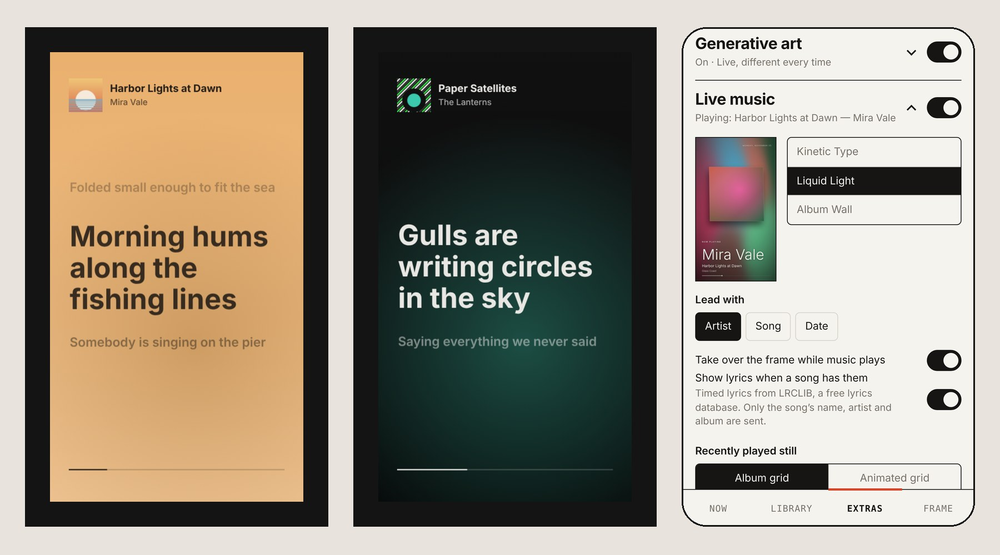

# eo-frame

**Bring an Electric Objects EO2 (or EO1) frame back to life after its servers shut down, and run it from your phone.**


Electric Objects frames were made to show art from a cloud service that no longer exists. This
project puts a replacement app on the frame and gives it a phone-friendly web page on your home
network. You can add photos and GIFs, choose what's in rotation, set how often pictures change and
when the screen sleeps, and put a few living things on the wall: today's newspaper front page or the
albums you've been playing. There are no accounts, no subscription and no cloud service in the middle.

> **This is a fork of [aphex3k/EO1](https://github.com/aphex3k/EO1)**, the frame app by
> aphex3k, which itself began as a rewrite of Dan Finkelstein's [spalt/EO1](https://github.com/spalt/EO1).
> Everything in `app/` is aphex3k's app with this fork's phone page and extras committed on top.
> aphex3k's own README is kept in full as [UPSTREAM-README.md](UPSTREAM-README.md). See
> [Where this comes from](#where-this-comes-from).

## What you can do from your phone


- **Add photos and GIFs.** Photos are resized and converted on your phone before they're sent,
  so iPhone HEIC photos work and the frame gets small, ready-to-show files. Choose **Fill** (crop
  to the frame) or **Whole** (the full photo on a blurred background). Animated GIFs play as GIFs.
- **See what's on and what's coming up.** The Now tab opens with the controls, then one row: the
  first, larger slot is what's on the frame right now, followed by what's next with times,
  including the live art and music pages and the extras.
- **Manage the rotation.** Your library is laid out as one row per source (photos, kept art, NYT
  and Spotify). Tap a picture to preview it, **Show now** or **Remove** it, or select several.
- **Control the frame:** next picture, screen on or off, and a brightness slider, at the top of the
  Now tab.
- **Bring in other sources:** your own Immich server, a Flickr stream or any web page, added from the
  phone. The frame's browser is from 2013, so simple pages work best. When a site's certificate or
  ciphers are too new for it, the frame fetches that site through the same modern TLS library the
  Spotify client uses. The phone page says whether each web page showed, failed or came up blank.
- **Choose what's on the wall:** switch Photos, Generative art, the NYT front page and Spotify on or
  off in any mix, and choose how often art comes up.
- **Never fills up.** Old generated images (yesterday's front page, last week's album grid) are
  cleaned up automatically, and the frame refuses uploads that would nearly fill it.
- **Simple settings:** how often the picture changes (1 minute to 1 day), night-time sleep hours,
  time zone, and the frame's name.
- **Look after the frame:** update it, restart the app or reboot the frame from the Frame tab,
  no computer needed. An update left waiting that's older than what's running is cleared on its
  own, or with **Discard**.
- **Four simple tabs:** Now, Library, Extras and Frame. Add it to your home screen and it opens
  like an app.

### Extras


- **Generative art.** Twelve animated styles (watercolor washes, Bauhaus blocks, rolling hills,
  drifting dots, contour rings, a striped sunset and more) drawn live on the frame. Every time a
  piece comes up it picks a new style and seed, so it's never the same twice. Pick which styles
  you like, preview them on your phone, and keep any frame you love as a still.


- **The New York Times front page.** Today's print front page, clean, glitched, or as an
  animated glitch GIF. Your phone fetches and renders it, and it replaces yesterday's.
- **Spotify, live.** Connect once from your phone and the frame keeps up with your music on its
  own. Three animated now-playing styles: **Kinetic Type** (a bold typographic poster that
  re-flows as tracks change), **Liquid Light** (the cover's colors flowing behind it) and
  **Album Wall** (your recent covers drifting in columns behind the current album). Lead with the
  artist, the song or the date, and let it take over the frame while music plays. There's also a
  still or animated grid of the albums you've played recently.
  One-time setup: [SPOTIFY-AND-TAILSCALE.md](kit/SPOTIFY-AND-TAILSCALE.md).
- **Lyrics, optional.** Switch on **Show lyrics when a song has them** and, when a song has timed
  lyrics, the music page shows the current line large over the album's colors, with the lines
  before and after dimmed, in step with the song. Lyrics come from [LRCLIB](https://lrclib.net), a
  free, community-run lyrics database; only the song's name, artist, album and length are sent.
  Songs without timed lyrics keep your chosen style. Off by default.


- **Away from home:** reach the page over [Tailscale](kit/SPOTIFY-AND-TAILSCALE.md#tailscale-the-phone-page-from-anywhere).

## Set up an EO2 (about 10 minutes, no keyboard)

Not sure which frame you have? The EO2 has no buttons; the EO1 has two soft-touch buttons on the
back and a light sensor. aphex3k's [Which frame is this?](UPSTREAM-README.md#which-frame-is-this)
table has the full comparison. For an EO1, skip to [Set up an EO1](#set-up-an-eo1-keyboard-and-mouse-about-15-minutes).

The EO2 accepts Android's debugging connection (ADB) over Wi-Fi, so everything happens from a computer
on the same network. You need a Mac (or Linux, or Windows with WSL) and the frame on your Wi-Fi.

1. Download `setup-eo2.sh` from [`kit/`](kit/) and the frame app APK. Until a release is
   published (see [Licensing](#licensing)), build the APK yourself: see
   [Building the frame app](#building-the-frame-app). Put both in one folder.
2. In Terminal, from that folder:
   ```bash
   bash setup-eo2.sh
   ```
   The script installs `adb` if needed (via Homebrew), finds the frame on your network and turns
   off the original Electric Objects apps, so the "Select a home app" screen doesn't come back.
   It then asks for your time zone, interval and sleep hours, installs the app and reboots. It
   asks before every change.
3. Open `http://<frame-ip>:8080/` on your phone (the script prints the address) and add photos.

To install a newer build later: on the phone page, **Frame → Update the frame**, or
`bash update-eo2.sh <frame-ip>` with the new APK in the folder.
Manual steps and troubleshooting: [kit/EO2-SETUP.md](kit/EO2-SETUP.md).

**Security note:** the EO2 leaves ADB open on your network with full control of the frame, and the
phone page has no login. That's fine on a home network you trust. Don't put the frame on public or
guest Wi-Fi, and don't expose its page to the internet.

## Set up an EO1 (keyboard and mouse, about 15 minutes)

> **Untested on an EO1 so far.** The app this fork builds on supports both frames and detects which
> one it's on, and everything this fork adds runs inside that app, so it should work. If you try
> it, please [open an issue](https://github.com/shellen/eo-frame/issues) and say how it went,
> good or bad.

The EO1 doesn't accept a wireless connection from a computer, so the setup scripts in `kit/` don't
work on it. Instead you install the app through the frame's own browser, once, with a keyboard and
mouse plugged in. You need:

- a USB keyboard and mouse, and a USB OTG adapter (or hub) for the frame's single data port
- the frame on your Wi-Fi (join it in the frame's own Settings, with the keyboard)
- a computer on the same Wi-Fi, holding the APK. Until a release is published (see
  [Licensing](#licensing)), build it yourself: see [Building the frame app](#building-the-frame-app)

Steps:

1. **Share the APK on your network.** In Terminal, from the folder holding the APK:
   ```bash
   python3 -m http.server 8000
   ```
   Leave it running. Find your computer's address (on a Mac: System Settings → Wi-Fi → Details).
2. **Open the frame's browser.** Plug in the keyboard and mouse, power the frame on, and when it
   stops at the "Getting Art" screen press **Windows + B**.
3. **Allow the install.** Swipe down from the top right, open **Settings → Security** and tick
   **Unknown sources**.
4. **Download and install.** Back in the browser, go to
   `http://<your-computer's-address>:8000/` and tap the APK. When it finishes, pull down the
   notification bar on the top left, tap the download and agree to the install prompts.
5. **Make it the home screen.** Unplug the power and plug it back in (leave the keyboard and mouse
   connected). When the frame asks which app to use as the home screen, pick **EO1** and
   **Always**.
6. **Turn on uploads from the phone.** The app opens its options dialog on first run. On the
   **Media** tab, click **+ Add Local uploads**, then **Save**. This is the one step that needs the
   mouse.
7. Open `http://<frame-ip>:8080/` on your phone and add photos. You can unplug the keyboard and
   mouse and stop the `http.server` command.

How an EO1 differs once it's running:

- **Brightness follows the room.** The EO1 has a light sensor, so the phone page's brightness slider
  sets the lowest it will go. The two buttons on the back still work: the top one turns the screen
  on or off and BACK steps the brightness.
- **Updates from the phone may need a click.** On the EO2 the frame installs an update on its own.
  On an EO1 it will probably stop at Android's "Install?" prompt, so plug the mouse in and confirm.
  **Reboot the frame** may not work for the same reason; **Restart the app** does.
- **Less storage.** The EO1 has a smaller drive. Old generated images are cleaned up automatically
  and the frame refuses uploads that would nearly fill it.
- **Already running aphex3k's EO1 app?** This fork's build is signed differently, so Android won't
  update over it. Uninstall the old app first (its uploaded photos and settings go with it), then
  follow the steps above.

aphex3k's longer guide, including writing the settings file by hand, is in
[docs/SETUP.md](docs/SETUP.md#setup-for-eo1).

## Questions, problems and ideas

Please [open an issue](https://github.com/shellen/eo-frame/issues). It helps to include:

- which frame (EO1 or EO2) and the app version (Frame tab → App)
- what you did and what you saw; a photo of the frame or a screenshot of the phone page is great
- for display problems, the last few lines starting with `web:` from `http://<frame-ip>:8080/logs`

Problems that also happen with aphex3k's original app may belong upstream at
[aphex3k/EO1](https://github.com/aphex3k/EO1/issues).

## What's in this repo

| Path | What it is |
|---|---|
| `app/` | The frame app: aphex3k/EO1 plus this fork's commits (phone page, live art and music pages, frame-side Spotify, Up next, source switches, storage cleanup, update and reboot from the phone) |
| [`kit/`](kit/) | Setup and update scripts, the setup guide, the Spotify and Tailscale guide, the Spotify login bounce page, and an optional Mac script for a daily front page |
| [`docs/eo-frame/`](docs/eo-frame/) | README images. All the art in them is generated, and the frame data shown is made up |
| [`UPSTREAM-README.md`](UPSTREAM-README.md), `docs/`, `AGENTS.md` | aphex3k's documentation, unchanged |

## Building the frame app

Build from the repo root with the Android SDK (API 34) and JDK 17, signing with your own key. Put
the key in `local.properties`:

```properties
sdk.dir=/path/to/android-sdk
eo1.signing.store.file=/path/to/your-release.jks
eo1.signing.store.password=…
eo1.signing.key.alias=EO1
eo1.signing.key.password=…
```

```bash
./gradlew assembleRelease -PVERSION_NAME=2.0.12 -PVERSION_CODE=20012
```

The APK lands in `app/build/outputs/apk/release/`. Raise `VERSION_CODE` with every build, because
the frame only installs a newer version, and keep using the same key so updates install in place.
If you sign with your own key, set `RELEASE_CERT_SHA256` in
`app/src/main/java/com/aphex3k/eo1/BuildFacts.java` to its fingerprint, and point `SP_BOUNCE` in
`app/src/main/resources/web/mobile.html` at your own GitHub Pages copy of
`kit/spotify/callback.html`.

## Where this comes from

- **Dan Finkelstein** wrote the first replacement app, [spalt/EO1](https://github.com/spalt/EO1),
  when Electric Objects shut down.
- **aphex3k** rewrote it from scratch as [aphex3k/EO1](https://github.com/aphex3k/EO1): local
  uploads, Immich, Flickr, web pages, quiet hours, the TLS work for Android 4.4, the Amlogic video
  player, self-healing and much more. That is the app that runs the frame.
- **This fork** adds a phone-first web page and extras on top (listed above), committed as normal
  commits so the history shows exactly what changed. GitHub's "Sync fork" pulls in aphex3k's
  updates.

### Where this fork differs from upstream's rules

aphex3k's `AGENTS.md` sets rules for that project. A few of this fork's choices deliberately go a
different way, for a phone-first home setup:

- Old generated images (the previous front page, an old album grid) are deleted from
  `files/uploaded` automatically. Photos and kept art are never deleted.
- Gallery thumbnails and an album-art cache are served from outside `files/uploaded`.
- The phone page can reboot the frame without the options-dialog opt-in.
- The phone page can install an APK without Trusted Network. It still has to be signed with the
  installed app's key and be a newer version.
- The phone page can add, switch and remove Immich, Flickr and web-page sources without Trusted
  Network. Passwords and keys are write-only: the page never reads them back.

## Licensing

aphex3k/EO1 doesn't include a license. This fork exists under GitHub's terms, which let anyone
view and fork public repositories on GitHub, and it doesn't grant any license to aphex3k's code.
For that reason no signed APK is published here until aphex3k says how they'd like the code to be
shared. The bundled fonts are under the SIL Open Font License (see `app/src/main/resources/web/fonts/`).

## Credits

- **[aphex3k/EO1](https://github.com/aphex3k/EO1)**: the frame app this fork is built on.
- **[spalt/EO1](https://github.com/spalt/EO1)** and **Dan Finkelstein**: the original replacement
  app that started the revival.
- [Conscrypt](https://github.com/google/conscrypt) provides modern TLS for the frame's Spotify
  connection.
- [Familjen Grotesk](https://github.com/Familjen-Sthlm/Familjen-Grotesk) (headings) and
  [Shantell Sans](https://github.com/arrowtype/shantell-sans) (the optional hand-drawn style) are
  bundled with the app under the SIL Open Font License.
- [pdf.js](https://mozilla.github.io/pdf.js/) and [gifenc](https://github.com/mattdesl/gifenc)
  are loaded by the phone page for the front page and the GIFs.

Not affiliated with Electric Objects, The New York Times, Spotify or Tailscale. The front-page
feature is meant for personal display at home; the scan is the Times' copyrighted work.
