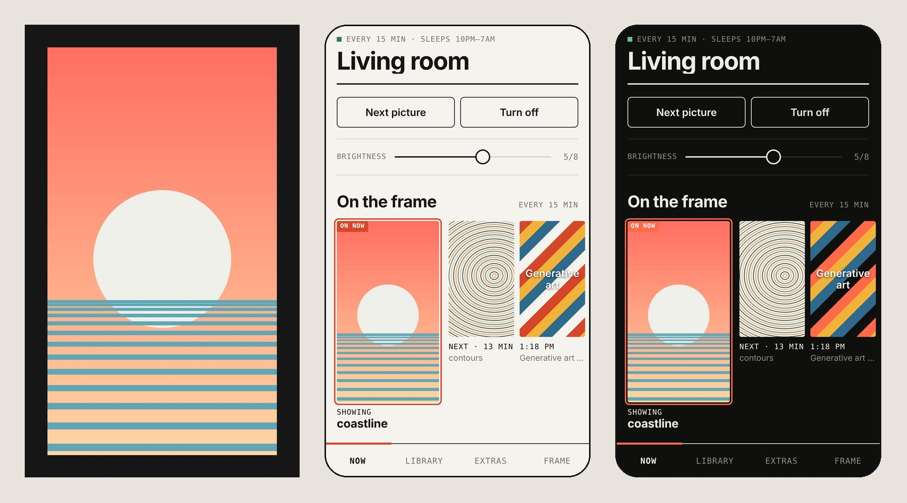
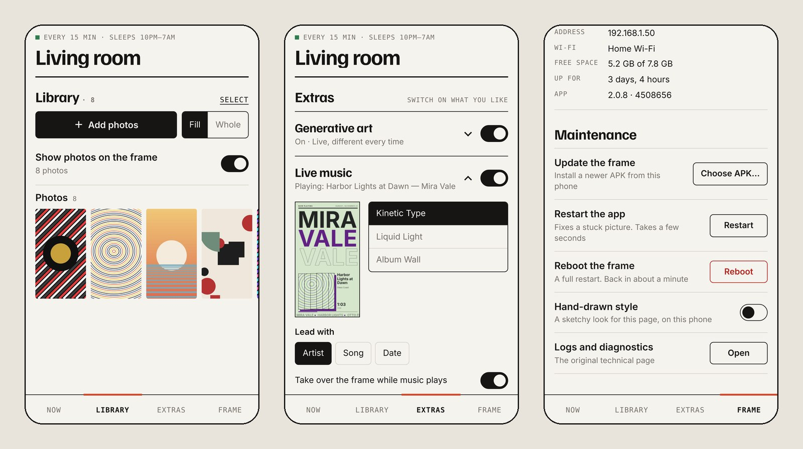
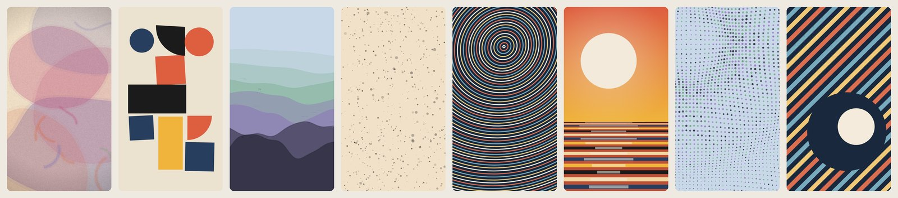
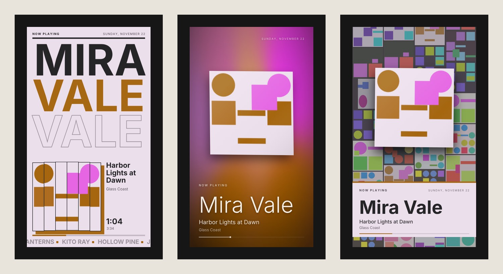

# eo-frame

**Bring an Electric Objects EO2 frame back to life after its servers shut down, and run it from your phone.**



Electric Objects frames were made to show art from a cloud service that no longer exists. This
project puts a replacement app on the frame and gives it a phone-friendly web page on your home
network. You can add photos and GIFs, choose what's in rotation, set how often pictures change and
when the screen sleeps, and put a few living things on the wall: today's newspaper front page or the
albums you've been playing. There are no accounts, no subscription and no cloud service in the middle.

> **This is a fork of [aphex3k/EO1](https://github.com/aphex3k/EO1)**, the frame app by
> aphex3k, which itself began as a rewrite of Dan Finkelstein's [spalt/EO1](https://github.com/spalt/EO1).
> Everything in `app/` is aphex3k's app with this fork's phone page and extras committed on top.
> aphex3k's own README is kept in full as [UPSTREAM-README.md](UPSTREAM-README.md). See
> [Where this comes from](#where-this-comes-from).

## What you can do from your phone



- **Add photos and GIFs.** Photos are resized and converted on your phone before they're sent,
  so iPhone HEIC photos work and the frame gets small, ready-to-show files. Choose **Fill** (crop
  to the frame) or **Whole** (the full photo on a blurred background). Animated GIFs play as GIFs.
- **See what's on and what's coming up.** The Now tab opens with the controls, then one row: the
  first, larger slot is what's on the frame right now, followed by what's next with times,
  including the live art and music pages and the extras.
- **Manage the rotation.** Your library is laid out as one row per source (photos, kept art, NYT
  and Spotify). Tap a picture to preview it, **Show now** or **Remove** it, or select several.
- **Control the frame:** next picture, screen on or off, and a brightness slider, at the top of the
  Now tab.
- **Bring in other sources:** your own Immich server, a Flickr stream or any web page, added from the
  phone. The frame's browser is from 2013, so simple pages work best. When a site's certificate or
  ciphers are too new for it, the frame fetches that site through the same modern TLS library the
  Spotify client uses. The phone page says whether each web page showed, failed or came up blank.
- **Choose what's on the wall:** switch Photos, Generative art, the NYT front page and Spotify on or
  off in any mix, and choose how often art comes up.
- **Never fills up.** Old generated images (yesterday's front page, last week's album grid) are
  cleaned up automatically, and the frame refuses uploads that would nearly fill it.
- **Simple settings:** how often the picture changes (1 minute to 1 day), night-time sleep hours,
  time zone, and the frame's name.
- **Look after the frame:** update it, restart the app or reboot the frame from the Frame tab,
  no computer needed. An update left waiting that's older than what's running is cleared on its
  own, or with **Discard**.
- **Four simple tabs:** Now, Library, Extras and Frame. Add it to your home screen and it opens
  like an app.

### Extras



- **Generative art.** Twelve animated styles (watercolor washes, Bauhaus blocks, rolling hills,
  drifting dots, contour rings, a striped sunset and more) drawn live on the frame. Every time a
  piece comes up it picks a new style and seed, so it's never the same twice. Pick which styles
  you like, preview them on your phone, and keep any frame you love as a still.



- **The New York Times front page.** Today's print front page, clean, glitched, or as an
  animated glitch GIF. Your phone fetches and renders it, and it replaces yesterday's.
- **Spotify, live.** Connect once from your phone and the frame keeps up with your music on its
  own. Three animated now-playing styles: **Kinetic Type** (a bold typographic poster that
  re-flows as tracks change), **Liquid Light** (the cover's colors flowing behind it) and
  **Album Wall** (your recent covers drifting in columns behind the current album). Lead with the
  artist, the song or the date, and let it take over the frame while music plays. There's also a
  still or animated grid of the albums you've played recently.
  One-time setup: [SPOTIFY-AND-TAILSCALE.md](kit/SPOTIFY-AND-TAILSCALE.md).
- **Lyrics, optional.** Switch on **Show lyrics when a song has them** and, when a song has timed
  lyrics, the music page shows the current line large over the album's colors, with the lines
  before and after dimmed, in step with the song. Lyrics come from [LRCLIB](https://lrclib.net), a
  free, community-run lyrics database; only the song's name, artist, album and length are sent.
  Songs without timed lyrics keep your chosen style. Off by default.


- **Away from home:** reach the page over [Tailscale](kit/SPOTIFY-AND-TAILSCALE.md#tailscale-the-phone-page-from-anywhere).

## Set up a frame (about 10 minutes, no keyboard)

The EO2 accepts Android's debugging connection (ADB) over Wi-Fi, so everything happens from a computer
on the same network. You need a Mac (or Linux, or Windows with WSL) and the frame on your Wi-Fi.

1. Download `setup-eo2.sh` from [`kit/`](kit/) and the frame app APK. Until a release is
   published (see [Licensing](#licensing)), build the APK yourself: see
   [Building the frame app](#building-the-frame-app). Put both in one folder.
2. In Terminal, from that folder:
   ```bash
   bash setup-eo2.sh
   ```
   The script installs `adb` if needed (via Homebrew), finds the frame on your network and turns
   off the original Electric Objects apps, so the "Select a home app" screen doesn't come back.
   It then asks for your time zone, interval and sleep hours, installs the app and reboots. It
   asks before every change.
3. Open `http://<frame-ip>:8080/` on your phone (the script prints the address) and add photos.

To install a newer build later: on the phone page, **Frame → Update the frame**, or
`bash update-eo2.sh <frame-ip>` with the new APK in the folder.
Manual steps and troubleshooting: [kit/EO2-SETUP.md](kit/EO2-SETUP.md).

**Security note:** the EO2 leaves ADB open on your network with full control of the frame, and the
phone page has no login. That's fine on a home network you trust. Don't put the frame on public or
guest Wi-Fi, and don't expose its page to the internet.

## What's in this repo

| Path | What it is |
|---|---|
| `app/` | The frame app: aphex3k/EO1 plus this fork's commits (phone page, live art and music pages, frame-side Spotify, Up next, source switches, storage cleanup, update and reboot from the phone) |
| [`kit/`](kit/) | Setup and update scripts, the setup guide, the Spotify and Tailscale guide, the Spotify login bounce page, and an optional Mac script for a daily front page |
| [`docs/eo-frame/`](docs/eo-frame/) | README images. All the art in them is generated, and the frame data shown is made up |
| [`UPSTREAM-README.md`](UPSTREAM-README.md), `docs/`, `AGENTS.md` | aphex3k's documentation, unchanged |

## Building the frame app

Build from the repo root with the Android SDK (API 34) and JDK 17, signing with your own key. Put
the key in `local.properties`:

```properties
sdk.dir=/path/to/android-sdk
eo1.signing.store.file=/path/to/your-release.jks
eo1.signing.store.password=…
eo1.signing.key.alias=EO1
eo1.signing.key.password=…
```

```bash
./gradlew assembleRelease -PVERSION_NAME=2.0.12 -PVERSION_CODE=20012
```

The APK lands in `app/build/outputs/apk/release/`. Raise `VERSION_CODE` with every build, because
the frame only installs a newer version, and keep using the same key so updates install in place.
If you sign with your own key, set `RELEASE_CERT_SHA256` in
`app/src/main/java/com/aphex3k/eo1/BuildFacts.java` to its fingerprint, and point `SP_BOUNCE` in
`app/src/main/resources/web/mobile.html` at your own GitHub Pages copy of
`kit/spotify/callback.html`.

## Where this comes from

- **Dan Finkelstein** wrote the first replacement app, [spalt/EO1](https://github.com/spalt/EO1),
  when Electric Objects shut down.
- **aphex3k** rewrote it from scratch as [aphex3k/EO1](https://github.com/aphex3k/EO1): local
  uploads, Immich, Flickr, web pages, quiet hours, the TLS work for Android 4.4, the Amlogic video
  player, self-healing and much more. That is the app that runs the frame.
- **This fork** adds a phone-first web page and extras on top (listed above), committed as normal
  commits so the history shows exactly what changed. GitHub's "Sync fork" pulls in aphex3k's
  updates.

### Where this fork differs from upstream's rules

aphex3k's `AGENTS.md` sets rules for that project. A few of this fork's choices deliberately go a
different way, for a phone-first home setup:

- Old generated images (the previous front page, an old album grid) are deleted from
  `files/uploaded` automatically. Photos and kept art are never deleted.
- Gallery thumbnails and an album-art cache are served from outside `files/uploaded`.
- The phone page can reboot the frame without the options-dialog opt-in.
- The phone page can install an APK without Trusted Network. It still has to be signed with the
  installed app's key and be a newer version.
- The phone page can add, switch and remove Immich, Flickr and web-page sources without Trusted
  Network. Passwords and keys are write-only: the page never reads them back.

## Licensing

aphex3k/EO1 doesn't include a license. This fork exists under GitHub's terms, which let anyone
view and fork public repositories on GitHub, and it doesn't grant any license to aphex3k's code.
For that reason no signed APK is published here until aphex3k says how they'd like the code to be
shared. The bundled fonts are under the SIL Open Font License (see `app/src/main/resources/web/fonts/`).

## Credits

- **[aphex3k/EO1](https://github.com/aphex3k/EO1)**: the frame app this fork is built on.
- **[spalt/EO1](https://github.com/spalt/EO1)** and **Dan Finkelstein**: the original replacement
  app that started the revival.
- [Conscrypt](https://github.com/google/conscrypt) provides modern TLS for the frame's Spotify
  connection.
- [Familjen Grotesk](https://github.com/Familjen-Sthlm/Familjen-Grotesk) (headings) and
  [Shantell Sans](https://github.com/arrowtype/shantell-sans) (the optional hand-drawn style) are
  bundled with the app under the SIL Open Font License.
- [pdf.js](https://mozilla.github.io/pdf.js/) and [gifenc](https://github.com/mattdesl/gifenc)
  are loaded by the phone page for the front page and the GIFs.

Not affiliated with Electric Objects, The New York Times, Spotify or Tailscale. The front-page
feature is meant for personal display at home; the scan is the Times' copyrighted work.
